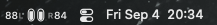
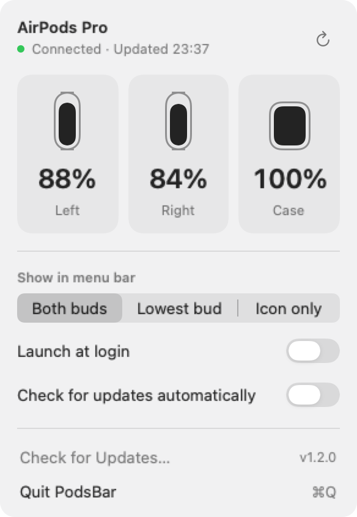

# PodsBar

AirPods battery in the macOS menu bar. Each bud is a capsule that fills up, with its own
percentage next to it.





## Install

macOS 14+. Download the app ZIP from the [latest release](https://github.com/musaAmir/podsbar/releases/latest),
extract it, quit any running copy of PodsBar, and copy PodsBar.app to /Applications.
Version 1.1.0 is ad-hoc signed and not notarized by Apple; macOS may block its first launch.

Building from source requires Xcode with Swift 6 or newer:

```sh
./build.sh
cp -R build/PodsBar.app /Applications/
```

Open it from /Applications, then tick **Launch at login**. If macOS needs approval,
use **Allow in System Settings…** in the popover.

## Use

- Choose both battery percentages, the lowest bud, or just the capsules.
- When multiple sets are connected, choose a preferred device in the popover. Automatic
  selection prefers devices with earbud readings over case-only records. If your preferred
  device disconnects, PodsBar shows another connected device until it returns.
- AirPods Max and other single-battery headphones show one battery.
- Missing readings show `—`. Case levels depend on what macOS reports; they can be missing
  or stale when the case is closed.
- Use the refresh button for an immediate scan. If a scan fails, the popover identifies
  any displayed levels as the last known readings and shows the error.
- Use **Check for Updates…** to check immediately, or leave daily automatic checks enabled.
  Sparkle asks before downloading and installing an update by default. Automatic checks
  can be turned off in the popover.

## Lightweight by design

PodsBar reads `system_profiler SPBluetoothDataType` rather than private IOKit battery keys.
It polls once a minute with devices connected, or every two minutes without them. Timers
allow macOS to coalesce wake-ups, and polling pauses during system sleep.

Connection changes and wake trigger refreshes, with one coalesced follow-up for delayed
Bluetooth battery reports. Opening the popover reuses readings less than 15 seconds old.
Only one scan runs at a time; each scan has a deadline and a 1 MiB output limit.

The menu bar uses AppKit. The SwiftUI popover is created on demand and its view controller
is released when closed. There is no repeating UI timer, and only the current menu-bar
image is cached. Sparkle is the only third-party runtime dependency and handles daily update
checks without another app polling loop. Unused sandbox XPC services are removed from the
packaged framework. No analytics or accounts; battery data stays on your Mac. Update checks
contact GitHub and its download hosts. No Dock icon or Bluetooth permission prompt.

See [performance notes](docs/performance.md) for measurements and their limits.

## Development

```sh
swift test
./build.sh debug
```

Tests cover report parsing, device selection, scan failures, subprocess cancellation and
limits, sleep/wake races, connection-event coalescing, and updater configuration. GitHub
Actions also tests release metadata and real Sparkle signing with a disposable test key,
and builds both architectures on pushes and pull requests.

## Public releases

See the [update and release guide](docs/updates.md) for the one-time signing setup and the
commands to build, notarize, sign the update feed, and upload a GitHub draft release.

**Existing installations without Sparkle need one manual download of the first
Sparkle-enabled release.** Later versions can update through the app. The update feed
becomes available when the first GitHub release containing `appcast.xml` is published.

Build a universal app for Apple silicon and Intel Macs:

```sh
VERSION=1.0.0 BUILD_NUMBER=1 \
CODESIGN_IDENTITY="Developer ID Application: Your Name (TEAMID)" \
./build.sh release universal
```

Without `CODESIGN_IDENTITY`, the script creates an ad-hoc signed app for local use.
Release builds strip local symbols. The script verifies the signature before replacing
an existing build, and bundles the MIT license.

For downloads intended for the public, sign with Developer ID, notarize the app, and
staple the ticket before packaging the final download. Follow Apple's
[notarization instructions](https://developer.apple.com/documentation/security/notarizing-macos-software-before-distribution).
The build script enables the hardened runtime and a secure timestamp when a signing
identity is supplied; it does not submit anything to Apple or publish a release.

Before publishing, test the packaged app on macOS 14 and a current macOS version, on
Apple silicon and Intel. Check connection/disconnection, wake, missing case levels,
multiple devices, all display modes, keyboard navigation, and launch at login from
/Applications. Unit tests and cross-compilation do not replace those hardware checks.

## Licence

MIT
